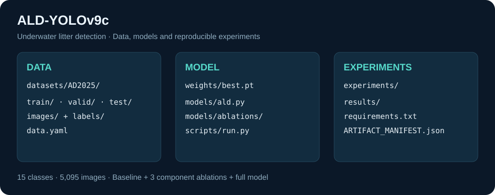

# ALD-YOLOv9c

### Underwater litter detection with dynamic convolution and feature attention

**[Ifzashad](https://github.com/Ifzashad)** · PyTorch · Computer vision · Reproducible research

A complete research project: a 15-class detector, the bundled **AD2025** dataset,
trained checkpoints, component ablations and held-out evaluation results.
The weights directory includes the best checkpoint for all five experiments and
the original YOLOv9c initialization used for training.
This repository reconstructs the model implementation after the original code and
weights were lost. All results below are measurements from this reconstruction.



## Start here

The dataset is inside **`datasets/AD2025/`** and the full model is inside
**`weights/best.pt`**. Large binary files use Git LFS. Download the repository
with Git LFS to get the actual images and checkpoints, not just pointer files.

```bash
git lfs install
git clone https://github.com/Ifzashad/ALD-YOLOv9c.git
cd ALD-YOLOv9c
git lfs pull
python scripts/verify_artifacts.py
```

GitHub's source ZIP may contain LFS pointers. The published Release is intended
to additionally provide an AD2025 archive and a standalone `best.pt`; verify that
the release assets are present before relying on this alternative.

## Environment

Tested training environment: Linux, Python **3.10.22**, PyTorch **2.5.1+cu121**,
torchvision **0.20.1+cu121**, NVIDIA RTX 3090. `requirements.txt` records installed
Python distribution versions from the working project environment. CUDA wheels
require a compatible NVIDIA driver; pinned Python packages do not install drivers.
Other platforms and GPU configurations have not been validated.

```bash
conda create -n ald-yolov9c python=3.10.22 pip -y
conda activate ald-yolov9c
python -m pip install -r requirements.txt
python -m pip check
python ald_ablation_check.py
```

## Evaluate the trained model

Run from the repository checkout. Select a GPU allocated to you using `--device`.
The wrapper resolves dataset and output paths relative to the checkout, so no
original server directory is required.

```bash
python scripts/run.py evaluate --device 0
python scripts/run.py evaluate --weights weights/baseline-best.pt --device 0
```

Evaluation defaults: test split, 640 pixels, batch 8, FP32, confidence floor 0.001,
class-aware NMS IoU 0.7, maximum 300 detections. Outputs go to a new `runs/` folder,
including metrics JSON and evaluation plots. Use `--device cpu` for CPU evaluation;
it will be slower and has not been benchmarked on this dataset.

## Train and reproduce ablations

```bash
python scripts/run.py train --variant full --device 0
python scripts/run.py train --variant baseline --device 0
python scripts/run.py train --variant dyn-only --device 0
python scripts/run.py train --variant fa-only --device 0
python scripts/run.py train --variant wiou-only --device 0
```

Run these sequentially or allocate a separate GPU per process. Every experiment
starts from `weights/yolov9-c.pt`, the original COCO initialization, not the trained
full checkpoint. Model YAMLs are in `models/ablations/`; hyperparameters are in
`data/hyps/ablations/`; complete experiment specifications are in `experiments/`.

Shared settings: seed 0, image 640, batch 8, SGD, initial LR 0.001, momentum 0.931,
weight decay 0.0005, maximum 200 epochs, early-stopping patience 50, close mosaic 15.
Checkpoint selection uses validation. Reported test results were not used for tuning.
Early stopping does not guarantee absence of overfitting.

## Architecture

| Component | Placement |
|---|---|
| YOLOv9c | Retain backbone blocks, neck routing and the dual PGI detection architecture |
| DynConvLayer | Replace the two main backbone stem convolutions; four kernel experts |
| FA-Net | Channel and multi-scale spatial attention on main P3/P4/P5 before detection |
| W-IoU v3 | Box-regression loss in both detection branches; retain classification and DFL |

The full training graph contains **51,333,668 parameters**, including auxiliary
branches. No inference-only lightweight or real-time claim is made. See
`docs/RECONSTRUCTION_NOTES.md` for assumptions and differences from the manuscript.

## AD2025: included data

```text
datasets/AD2025/
├── data.yaml
├── train/  ── images/ + labels/
├── valid/  ── images/ + labels/
└── test/   ── images/ + labels/
```

| Train | Validation | Test | Total | Classes |
|---:|---:|---:|---:|---:|
| 3,626 | 968 | 501 | 5,095 | 15 |

Classes: Mask, can, cellphone, electronics, gbottle, glove, metal, misc, net,
pbag, pbottle, plastic, rod, sunglasses, tire. Image contents, class IDs and split
assignments are preserved. AD2025 is this project's local distribution name;
original export notices are retained inside the dataset folder.

## Held-out test results

501 images · 966 objects · validation-best checkpoints · one seed · values in %.

| Model | Precision | Recall | mAP50 | mAP50–95 |
|---|---:|---:|---:|---:|
| YOLOv9c baseline | 80.46 | 74.90 | 79.23 | 50.33 |
| + DynConv only | 78.40 | 75.52 | 77.20 | 50.21 |
| + FA-Net only | 79.04 | 75.53 | **79.43** | 49.78 |
| + W-IoU only | **81.18** | **75.97** | 77.12 | **50.54** |
| Full ALD-YOLOv9c | 73.68 | 75.01 | 76.28 | 49.50 |

**Outcome:** the full reconstruction does not outperform the baseline in this run.
Small single-component gains are not evidence of statistical significance.
Machine-readable scores and available training/evaluation plots are in `results/`.
The validation-loss columns inherited from the upstream trainer are uncomputed
zeros; do not interpret them as measured validation losses.

## External generalization

**Pending: GPU availability.** A six-shared-class SeaClear protocol has been
prepared. No external accuracy is reported yet. Frozen baseline/full models will
be evaluated on all 8,610 images and a declared 7,961-image sensitivity subset.
No exact overlap was found; unresolved perceptual-hash candidates prevent a claim
of guaranteed independence. External COCO AP will be reported separately.

## Reproducibility and credits

- Verify downloaded bytes with `scripts/verify_artifacts.py` and `ARTIFACT_MANIFEST.json`.
- Dependencies are pinned to the captured environment; fresh-install validation is
  still required before describing the release as verified on a clean machine.
- Source adaptation: WongKinYiu YOLOv9, commit `5b1ea9a8b3f0ffe4fe0e203ec6232d788bb3fcff`.
- Preserve `LICENSE.md` and upstream notices. Dataset notices remain with the data.
- CUDA deterministic `warn_only` mode allows some nondeterminism. Multiple seeds
  and deployment/export validation remain future work.

Maintained by [Ifzashad](https://github.com/Ifzashad).
